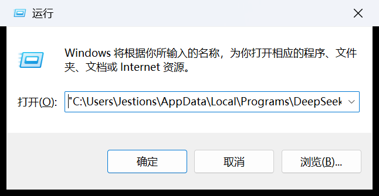
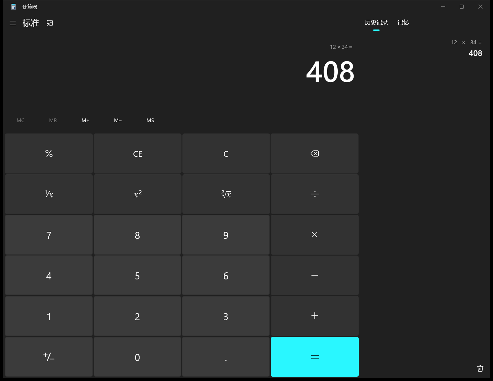
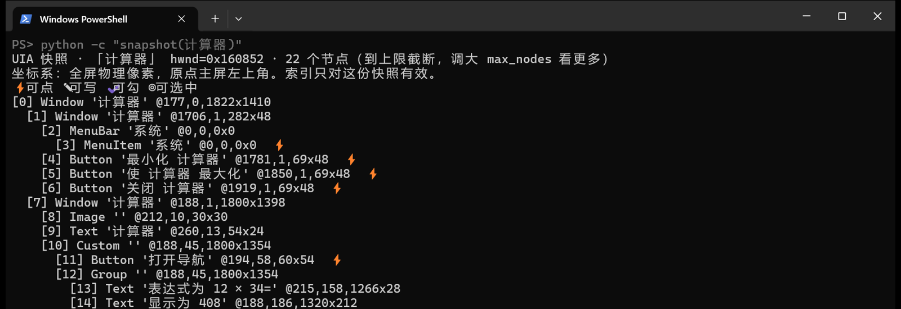

# desktop-mcp

给 agent 用的**桌面操作** MCP 服务器（Windows）。看屏幕、点鼠标、敲键盘、管窗口。

**纯工具，不做软件** —— 没有悬浮球、没有内置对话页、没有桌宠。
一切能力通过 MCP 暴露，由宿主 agent（DSH / Claude Code / Cursor…）驱动。

```
agent ──stdio JSON-RPC──▶ desktop-mcp ──SendInput/PrintWindow──▶ 你的屏幕
                                     ├─MCP image content──────▶ 截图回到模型眼里
                                     └─本地 HTTP──▶ Electron 子进程 ──▶ 屏幕上的发光框
```

---

## 快速开始

```bash
# 直接跑（无需安装）
python -m desktop_mcp.server                  # 全部 16 个工具
```

观察框（`desktop_highlight`）**不用预先启用**：首次调用会自动拉起 Electron 渲染进程，
常驻到你用 `desktop_frame_stop` 收掉它为止 —— 想省资源就收，下次用时再自动起。

### 挂到 DSH

```yaml
# ~/.dsh/profiles/<profile>/cordis.patch.yml
- id: mcp-desktop
  name: "@deepseek-ai/dsh-mcp-client"
  config:
    serverName: desktop
    transport: stdio
    command: "C:/Python314/python.exe"
    args: ["-m", "desktop_mcp.server", "--show-frame"]
    cwd: "C:/Users/<你>/.dsh/desktop-mcp"
    env: { PYTHONIOENCODING: "utf-8" }
```

### 依赖

只用两个已经装好的库，**没有引入任何新依赖**：

| 用途 | 用什么 |
|---|---|
| 输入注入（鼠标/键盘） | `ctypes` 直调 `SendInput`（标准库） |
| 窗口枚举/激活/度量 | `ctypes` 直调 `EnumWindows` / `SetForegroundWindow`（标准库） |
| 截屏 | `mss` |
| 图像编码与缩略 | `Pillow` |
| 观察框窗口 | `tkinter`（标准库，仅 `--show-frame` 时用到） |

---

## 实机能做到什么

**输入**：`win+r` 里塞一条几百字符的启动命令，不执行，只停在框里 ——
`desktop_uia_set_value` 直接写进 Edit 控件，不靠抢焦点打字。



**按控件点复选框**：Cloudflare Turnstile，点之前 / 点之后。

| 点之前 | 点之后 |
|---|---|
|  |  |

**算账**：12 × 34，六个按钮全部用 `desktop_uia_click`（Invoke 模式，**鼠标一次没动**）。

| 结果 | 同一时刻的控件树 |
|---|---|
|  |  |

右图是同一时刻 `desktop_uia_snapshot` 的输出，能直接看到
`[13] Text '表达式为 12 × 34='` 和 `[14] Text '显示为 408'` —— 左图是它看到的界面，
右图是它怎么看到界面的。

> 五张都是实拍，没有摆拍。Turnstile 那两张用的是 Cloudflare 的测试 sitekey
> （`3x…FF`，强制交互），所以底部带一行"仅用于测试"的提示。

## 工具（25 个，其中 1 个默认隐藏）

```
看      desktop_foreground_window  desktop_list_windows  desktop_screenshot
        desktop_measure_window     desktop_uia_snapshot  desktop_monitors
动      desktop_click   desktop_move  desktop_drag  desktop_scroll
        desktop_type    desktop_press desktop_click_human
按控件  desktop_uia_click  desktop_uia_set_value  desktop_uia_focus  desktop_uia_wait_for
窗口    desktop_focus_window
观察框  desktop_highlight  desktop_frame_start  desktop_frame_stop  desktop_frame_status
杂项    desktop_wait  desktop_clipboard  desktop_launch（默认隐藏）
```

两条路，别用混：

```
坐标路（截图 + 像素）        什么都看得见，但要眼睛估位置，窗口一动就得重看
控件路（UIA 树 + 索引）      纯文本、精确、不动鼠标，但 Electron/Chromium 里常常拿不到树
```

---

### 一、先看

#### `desktop_foreground_window` `screenshot`

当前哪个窗口在前台，含进程名、矩形，并截屏。

**输入之前先调它** —— 确认焦点真在你要操作的那个窗口上，免得把字打到别处。

#### `desktop_list_windows` `query | limit`

列可见窗口（前台排最前），或按关键词查。三个用途：

```
① 操作某个窗口前拿 hwnd
② 看某程序/网页有没有加载完（标题变了就是加载完了）
③ 没有 window 参数的工具用 query 定位目标
```

#### `desktop_screenshot` `window | hwnd | region | monitor | client_only | max_width`

**默认截当前前台窗口**，返回真正的图片附件。窗口被挡、一部分在屏幕外也能截到（PrintWindow 让它自己重绘）。

```
window="Chrome" 或 hwnd=12345     截别的窗口
window=false                      截整屏
client_only=true                  只要客户区，去掉标题栏和边框
max_width=1600                    降分辨率省 token，默认 1600
```

#### `desktop_measure_window` `hwnd | query`

量窗口矩形，**并直接给出中心点的 0–1000 分数坐标**。

```
要用分数坐标点控件时先用它换算 —— 比从截图肉眼估准得多。
注意坐标系：窗口矩形是物理像素，截图可能是缩放过的。
```

#### `desktop_uia_snapshot` `window | max_depth | max_nodes | include_offscreen`

抓无障碍树，输出纯文本控件清单：

```
UIA 快照 · 「任务栏」 hwnd=0x101C0 · 28 个节点
⚡可点 ✎可写 ✔可勾 ◎可选中
[0] Pane '任务栏' @0,1528,2560x72
  [8] Button '显示隐藏的图标' @2021,1528,48x72  ⚡
  [20] Button '音量 扬声器 (Realtek(R) Audio): 16%' @2303,1528,36x72  ⚡
```

```
原生 / WinUI（资源管理器、设置、对话框、任务栏）  → 树很全，优先用它
Electron / Chromium（DSH 自己、VSCode、浏览器）    → 常只有窗框几个按钮，退回截图
max_depth 默认 6（上限 16），max_nodes 默认 300（上限 2000）
```

#### `desktop_monitors`

显示器几何 + 虚拟桌面范围。多屏、异构缩放时要先知道边界在哪。

---

### 二、再动

#### `desktop_click` `x,y | fx,fy | button | clicks | wait | screenshot`

点一下，默认左键单击，**完成后自动截屏返回**。坐标缺省 = 当前光标位置。

```
分步移动再点 → 能触发悬停效果（下拉菜单、tooltip）
clicks=2     双击
wait=0.35    点完等几秒再截图，界面慢就调大
```

#### `desktop_move` `x,y | fx,fy`

只移动不点击。用来展开 hover 菜单、显示 tooltip，或把鼠标从挡视线的地方挪开。

#### `desktop_drag` `from_* → to_* | button | duration`

按住拖动，**分 20 步移动** —— 画布、滑块、拖放目标都需要中间事件，一步跳过去它们收不到。

#### `desktop_scroll` `amount | horizontal | x,y | fx,fy`

滚轮，正数向上/向右，一格 = 120。看网页一屏约 3 格（-360）。

**要滚某个区域必须给坐标**，否则滚的是光标当前所在的那个窗口。

#### `desktop_type` `text | method | x,y | fx,fy | per_char`

输入文字，**支持中文**（UNICODE 注入，绕过键盘布局）。

```
先点一下：给 x/y 会先移过去点一下，确保焦点落在目标上
method="clipboard"   剪贴板粘贴（会覆盖你剪贴板里的内容，只在 unicode 无效时用）
per_char=0.02        中文建议 0.02；默认 0.006
```

**⚠ 别把 per_char 设 0**：全速注入时记事本这类程序会把字符顺序搞乱、甚至和已有文本绞在一起，而工具照样报成功（实测踩过）。

#### `desktop_press` `keys | wait`

组合键，如 `"ctrl+s"`、`"alt+tab"`、`"win+r"`，或 `["ctrl","shift","esc"]`。顺序按下、逆序抬起，和真人按键一致。

#### `desktop_click_human` `x,y | fx,fy | trajectory | speed | jitter | time_jitter`

用**真人录制的鼠标轨迹**移过去再点 —— 不是两点一线。轨迹带着人手的过冲回调、不对称加减速和微小抖动，行为分析上更像人（普通 `desktop_click` 是瞬移式直线，一眼假）。

```
speed=2          节奏减半（想更慢更"人"）
jitter=2         每个点的随机抖动像素
time_jitter=0.15 时间也随机化 —— 设 0 会严格照录制节奏，重复调用一模一样
```

---

### 三、按控件（UIA 那一腿）

#### `desktop_uia_click` `index | button | clicks`

点快照里第 N 个控件。**优先走 UIA 的 Invoke / DoDefaultAction** —— 等于让程序自己按，**不动鼠标**，窗口被挡也能按。都不支持才退回鼠标点矩形中心。

```
已点 [11] Button '加粗(Ctrl+B)'（DoDefaultAction，没有动鼠标）
```

#### `desktop_uia_set_value` `index | text`

往第 N 个控件写值。**优先 ValuePattern**（程序自己设值，不动键盘），写不了才点进去全选再打字。

```
输入框优先用它，比 desktop_type 稳 —— 不受输入法、焦点、键盘布局影响
```

**⚠ 写完之后光标停在开头**。接着用 `desktop_type` 续写会插到最前面（实测：记事本里

「第一行」变成了第四行，因为 ValuePattern 把光标留在 0）。要追加就先 `desktop_press("ctrl+end")`。

#### `desktop_uia_focus` `index`

只把焦点给第 N 个控件，不点它。

#### `desktop_uia_wait_for` `window | name | control_type | timeout | interval`

等某个控件出现，**比 sleep 固定秒数靠谱**：界面什么时候好，让它自己说。

```
等运行框出现   desktop_uia_wait_for(control_type="Edit", timeout=3)
等网页加载完   desktop_uia_wait_for(name="登录", timeout=15)
等窗口起来     desktop_uia_wait_for(name="Edge", control_type="Window", timeout=15)
```

**⚠ 不传 control_type 时可能匹配到同名的别的东西。** 实测：等 `name="Edge"` 先命中的是
桌面上那个「Microsoft Edge」图标（ListItem），不是浏览器窗口 —— 等窗口就带上
`control_type="Window"`，或者直接 `desktop_list_windows(query=…)` 看标题。

**索引只对同一份快照有效，而且动手前会校验身份。** 每次 `click` / `set_value` 都按同样参数重走一遍树，
再比对目标节点的「类型 + 名字 + AutomationId」；对不上就**拒绝执行**并让你重新快照，不会赌。

```
实测：计算器按下第一个数字后，"显示为 12" 让树多了一层
     原来是 Button「三」的位置，变成了一个 Text 节点 ——
     没有校验时就会去点它（换个界面，那可能是「删除」）
```

**写内容会改窗口标题**（记事本拿第一行当标题），所以按标题找窗口时要注意；用 `hwnd` 最稳。

---

### 四、窗口与观察

#### `desktop_focus_window` `hwnd | query | action`

激活 / 最大化 / 最小化 / 还原一个窗口。

**Windows 有前台锁定**：激活可能失败，提示里会说明 —— **不要反复重试**，让用户手点一下那个窗口。

#### `desktop_wait` `seconds | screenshot`

固定等待。**能用 `desktop_uia_wait_for` 的地方就别用它** —— 等条件比等时间准。

#### `desktop_highlight` `region | hwnd | query | x,y,width,height | hide`

在屏幕上画一个发光框，标出正在关注的位置 —— **给人看的**：用户能看见 agent 在看哪一块，不用猜。做连续操作、或长任务中途时用它。

#### `desktop_frame_start` / `desktop_frame_stop` / `desktop_frame_status`

观察框的渲染进程（常驻 Electron 子进程）。平时不用手动调 —— `desktop_highlight` 会自动起。

**框画不出来时先查 `desktop_frame_status`** —— 常见原因是 node_modules 链接丢了或 Electron 找不到。

---

### 五、杂项

#### `desktop_clipboard` `op | text`

读写剪贴板文本。`op=get`（默认）读，`op=set` 写。

```
命中率最高的用法：从网页/文档里拿一段，再粘贴到别处
读之前不用清空，写会覆盖原有内容
```

#### `desktop_launch` `target | args | cwd | wait | expect`（**默认隐藏**）

启动应用或 URL，等新窗口出现并回报 hwnd / 标题 / 矩形。

平时优先走这条路：

```
desktop_press("win+r")
desktop_uia_wait_for(control_type="Edit", timeout=3)   ← 等运行框真的出现，别瞎打
desktop_type("edge")
desktop_press("enter")
desktop_uia_wait_for(name="Edge", timeout=10)          ← 等窗口出现，比睡 3 秒靠谱
```

`desktop_launch` 只在三种情况用：

```
URL 直达       target="https://example.com" → 交给默认浏览器
要确定返回值   它等窗口出现再回报，不用猜是哪一个新窗口
名字在开始菜单  "msedge" / "计算器" 这种 PATH 找不到的，走 App Paths 解析
```

打开方式（改 profile 补丁里 `mcp-desktop` 的 env，重启 DSH）：

```yaml
env:
  PYTHONIOENCODING: "utf-8"
  DESKTOP_MCP_ENABLE_LAUNCH: "1"
```

关着的时候它**连 schema 都不占** —— 模型看不见，就不会去试。

---

## 坐标系（唯一的真相）

- 位置一律是**全屏物理像素**，原点在主屏左上角；多屏在左侧时 x 可为负
- 也接受 **0–1000 分数**（`fx`/`fy`），按整个虚拟桌面换算 ——
  只看缩略图也能估位置，不必知道真实分辨率
- **从截图预览上读坐标时先换算**：原图宽÷预览宽，再乘 DPI 缩放（150% 就再乘 1.5）
- 不确定窗口在哪、多大 → `desktop_measure_window` 直接给分数坐标

---

## 常见任务配方

**① 点一个按钮（有树）**

```
desktop_uia_snapshot(window="设置")
  → 找到 [12] Button '保存' @...
desktop_uia_click(index=12)
```

**② 点一个按钮（只有画面）**

```
desktop_screenshot(window="某 Electron 应用")
  → 看图估位置，或先 desktop_measure_window 求分数坐标
desktop_click(fx=734, fy=812)
```

**③ 填表单**

```
desktop_uia_snapshot()  → 找到输入框的 ✎ 节点
desktop_uia_set_value(index=N, text="……")
desktop_uia_click(index=保存按钮)
```

**④ 开应用**

```
desktop_press("win+r") → desktop_uia_wait_for(control_type="Edit")
→ desktop_type("edge") → desktop_press("enter")
→ desktop_uia_wait_for(name="Edge", timeout=10)
```

**⑤ 等加载，别瞎睡**

```
desktop_uia_wait_for(name="加载完成", timeout=20)   有树
desktop_list_windows(query="标题关键词")            没树，看标题变化
```

**⑥ 复制粘贴**

```
desktop_clipboard(op="get") 拿一段 → 处理 → desktop_clipboard(op="set", text=结果)
再在目标窗口里 desktop_press("ctrl+v")
```

**⑦ 长任务让人能看见**

```
desktop_highlight(query="目标窗口")   画个框
…操作若干步…
desktop_highlight(hide=True)          收起来
```

## screenshot 为什么默认截窗口

用 `PrintWindow(PW_RENDERFULLCONTENT)`：让**窗口自己重绘**到内存 DC。

好处是普通抓屏做不到的：

- 窗口**被别的窗口挡住**，照样拿到完整内容
- 窗口**一部分在屏幕外**，照样拿到
- 拿到的就是"这个程序画的界面"，不掺杂桌面和其他窗口

`window=false` 或 `monitor=n` 时退化为屏幕抓取。

---

## 两个已知边界（不是 bug，别当 bug 查）

### 1. 最小化窗口只能截到标题栏一条

Windows 对最小化窗口没有"离屏渲染缓冲"，`PrintWindow` 只能给出一条标题栏
（实测：237×39、灰度标准差 0.0）。**工具会明确警告**，并提示先
`focus_window` 还原再截图 —— 因为不警告的话，模型会误判成"窗口里什么都没有"，
然后去点一堆不存在的控件。

### 2. 不渲染到屏幕的内容，任何 GDI 抓屏都拿不到

硬件加速浮层（某些加密视频、部分 GPU 合成的 UI 元素）不属于窗口绘制内容，
`PrintWindow` 和普通抓屏**都**拿不到。要抓这类内容只有
`Windows.Graphics.Capture` 那条路（本工具没做）。

> 踩过的坑记一笔：曾经看到微信头像区是空白方块，误判成"GPU 合成抓不到"。
> 真相是**头像还在加载**（占位底色），第二次截就有了。
> **先怀疑"它本来就没画"，再怀疑采集方式。**

---

## 观察框：为什么现在用 Electron

`desktop_highlight` 在屏幕上画一个青紫渐变 + 柔光的边框，标出 agent 正在看的位置。
**渲染交给一个独立的 Electron 子进程**（`frame/`），Python 侧通过本地 HTTP 发指令。

一开始我是用 tkinter 写的（`overlay.py` 保留作参考，但已不再被引用）。换掉它是因为
三件**在 Tk 里根本解决不了**的事：

| 需求 | Tk | Electron |
|---|---|---|
| 柔和辉光 | **做不到** —— Tk 只有颜色键透明，半透明像素被 Windows 与**黑色**预合成，辉光变成一圈"黑色涂抹"（用户原话：很重的黑色发散） | `transparent: true` 是真·逐像素 alpha，CSS `drop-shadow` 直接可用 |
| 精确位置 | `geometry()` 受 DPI 缩放影响：要 830×530 实际得到 553×353；还出现过 Tk 自认已设好、Win32 侧仍停在 `0x0` | `setBounds()` 直接设原生窗口，实测误差 **0** |
| 采集排除 | 手写 ctypes 设 `WDA_EXCLUDEFROMCAPTURE` | `setContentProtection(true)` 一行 |
| 点击穿透 | 手写一堆 `WS_EX_*` 扩展样式 | `setIgnoreMouseEvents(true, {forward:true})` 一行 |

### 两个必须遵守的启动条件（全是实测踩出来的）

1. **spawn 时必须删掉环境变量 `ELECTRON_RUN_AS_NODE`。**
   DSH 自己带着它运行，继承下去会让 Electron **退化成纯 Node 模式** ——
   `require('electron')` 只拿到一个字符串路径，`app` / `BrowserWindow` 全是 undefined。
   这条是从 dsh-orb 的 `open-main.ts` 注释里读出来的，省了大量试错。
2. **命令走本地 HTTP，不要用 stdin。** Windows 上 Electron 读不到管道 stdin，
   会立刻触发 `end`，于是我们把"父进程还没说话"误判成"父进程走了"而自杀。
   现在：Electron 监听 `127.0.0.1` 的**随机端口**并报给 Python，Python POST 指令过去。

> 还有一条**曾经**是硬性要求、现在已经被便携版消掉的：`frame/node_modules` 必须指向
> 一份 npm 装的 electron。那只是因为"裸运行时 + Node 模式"才需要它 —— 换成便携版
> （app 装在运行时自己的 `resources/app/` 里）之后就不需要了。见下一节。

### 便携版：渲染引擎怎么打包

观察框需要 Electron。为了不必在目标机器上装 node 环境，**把官方运行时和我们的
app 打在一起**，得到一个自包含、可直接拷走的目录：

```
runtime/                          365 MB（不进版本库）
├── electron.exe                  官方 Electron 44（Chromium + Node + V8）
├── *.dll / *.pak / locales/...   它自带的依赖，照抄
└── resources/app/                ← 我们的 4 个文件（共 9.6 KB）
    ├── main.js                   主进程：开窗、setBounds、命令通道
    ├── index.html
    ├── frame.css                 渐变描边 + 四层 drop-shadow 辉光
    └── package.json              main: main.js
```

**关键点**：Electron 启动时会自动加载 `resources/app/` 里的 app，
所以**不需要传任何参数、也不需要 node_modules**。
（同时要删掉官方的 `resources/default_app.asar`，否则它可能抢先加载。）

`desktop_mcp/electron_frame.py` 按这个顺序找引擎，找到哪个用哪个：

1. 环境变量 `DESKTOP_MCP_ELECTRON`（临时换引擎）
2. `D:\ForDeepseek\DesktopMCP\runtime\electron.exe` ← **便携版，推荐**
3. dsh-orb 自带的运行时（裸二进制，要配 `frame/node_modules`）
4. DesktopAi 里 npm 装的那份（同上）

**体积是 Electron 的固有代价**（自带一整个浏览器内核），压不下去。要重建便携版：

```cmd
python tools\build_portable.py
```
（脚本会复制运行时、放入 app、删掉 default_app、并实测能否起来+画框。）

### 另一个隐蔽的时序坑

`hwnd` 原来只在 `did-finish-load` 之后才报给 Python。结果首次 `highlight` 时，
Python 一拿到"就绪"就立刻发 `show`，而那时**页面还没加载完、窗口没准备好** ——
HTTP 回包是 `{"ok":true}`，但**屏幕上一片空白**，非常难查。

修法：**窗口一创建就报 hwnd**（不等页面加载），Python 拿到端口即算就绪。

### 与 dsh-orb 的关系

观察框的**设计**借鉴自 [dsh-orb](https://github.com/mini-yifan/dsh-orb-cordis)（MIT，★217）：
透明分层窗口、采集排除、点击穿透、以及"外扩 stroke+glow 再夹到工作区"的几何算法。
代码是独立写的（Python + 自己的 Electron 主进程）。
作者源码副本放在项目文件夹 `D:\ForDeepseek\DesktopMCP\参考_dsh-orb\`，只作参考。

> 顺带记一笔 Tk 时代的教训，免得以后重犯：那个 `_to_color_keyed()` 的阈值不能取大
> （取 8 会把光晕最外围 alpha 只有 8~20 的那圈整片削平）；而且转换后 alpha 已烘进颜色，
> **在深色背景下看会误以为"光晕没了"**，判断真实强度要看原始 alpha 通道 —— 我在这上面被自己误导了两轮。

---

## 人味点击：`desktop_click_human`

`desktop_click` 是"起点 → 终点"一步到位，任何行为分析一眼就看得出不是人手。
**人手的移动有三个特征，一条直线给不出来**：

- 轻微过冲后回调（overshoot → correct）
- 速度剖面不对称：起步加速、中段峰值、**末端明显减速**
- 微小抖动与不精确的落点

`desktop_click_human` 用**真人录制的轨迹**走完这段路再点击。轨迹由独立工具
`tools/record_trajectory.py` 采集（真人在窗口里按住鼠标朝按钮拖、松开），
**MCP 服务器不含录制功能** —— 它只读、只放。

### 数据格式

每个点存 `[相对x, 相对y, 毫秒]`（相对**松手处**的偏移），所以回放时能按目标
距离缩放、绕终点旋转，**路径形状和速度剖面都保留**。一条典型的：

```json
{"points": [[462,-343,0], [461,-343,8], ...],
 "n": 228, "duration_ms": 2096, "straight_dist": 575.4,
 "end_screen_xy": [1053,1012],
 "cursor_check": {"tk_release":[1053,1012], "win32_cursor":[1052,1011], "delta":[-1,-1]}}
```

`cursor_check` 是录制时的**坐标交叉校验**：Tk 报的松手位置 vs Win32 的光标位置。
两者一致才说明录到的是物理像素（实测全部 ≤1px）。

**纯净度**：录的是 `B1-Motion`（按住拖行），**中途不产生任何点击**，
数据里也没有任何按键事件字段；回放时走完全部点**才发一次按下+抬起**。
`tools/check_purity.py` 用三重证据（字段、时间轴空档、路径跳变）验证这一点。

### 按方向挑轨迹：为什么四象限都要录

回放时会**优先挑原生方向接近目标的轨迹**（cos 相似度前 4 条里随机 80%，
另 20% 完全随机以保留变化）。这不是优化，是**必要的**——实测两种发力的
手部特征完全不同：

| 指标 | 拉（朝左下） | 推（朝右上） | 差异 |
|---|---|---|---|
| 平均采样点数 | 116 | 63 | 0.54× |
| 平均时长 | 983 ms | 565 ms | **0.57×** |
| 平均峰值速度 | 1984 px/s | 3512 px/s | **1.77×** |
| 收尾/峰值比 | 0.30 | 0.10 | 收得更急 |

速度剖面的形状也不一样：**"推"起步最猛然后一路衰减**（像弹出去），
**"拉"速度平稳、尾部缓收**（像稳稳拖过来）。

**旋转能保住路径形状，但保不住速度剖面** —— 把"推"的节奏用在"拉"的方向上
就不像人了。所以四个象限各录一组，让旋转角接近 0。

### 节奏也要有变化，而且**时长随距离缩放**

`time_jitter`（默认 ±15%）给每段间隔加随机扰动。**时间也是行为特征**：
严格照原时间戳的话，同一个目标点两次的节奏会一模一样 —— 路径有抖动、时间
没有，一样可疑。

更重要的：**时间轴会跟着路径一起缩放**（`plan_path(scale_time=True)`）。
这是量出来的，不是猜的 —— 28 条真人轨迹里：

```
「时长 vs 直线距离」   r = +0.38   ← 弱
「时长 vs 路径长度」   r = +0.86   ← 强
按距离分组平均速度：近 981 / 中 1006 / 远 916 px/s   ← 基本恒定
```

也就是 **人手的速度大致是个常数，时长 = 路程 ÷ 速度**。不缩放的话，
把一条 559px 的轨迹拉去走 2084px，时长仍是原值（速度降到 1/3.7）；
拿去走 100px 时更荒谬 —— 3.2 秒挪 100 像素。

> **一个测量陷阱，别重犯**：不要用"速度守恒"去验证这件事。轨迹的**绕路比
> 不是常数**（实测某条：录制时 1.10，缩放到 640px 后 1.57），拿
> `路径长度 ÷ 时长` 算出来的"速度"会虚报几十个百分点，得出一堆假警报。
> 正确判据是 **回放时间/录制时间 == 目标直线距离/录制直线距离**
> （`tools/check_speed_preserve.py` 测 112 组，最大误差 1.02%）。

---

## 协议合规（34 项检查全过）

用 `tools/check_protocol.py` 跑出来的结论。**其中两条最容易做错，值得单独说**：

**① `image` content 必须是独立项，不能把 base64 塞进 `text`。**
塞进 text 的话客户端不会渲染成图，模型就"看不见"屏幕了 —— 工具照样报成功。

```json
{"type": "content", "content": [
  {"type": "text",  "text": "屏幕：虚拟桌面 (0,0) 2560×1600 ..."},
  {"type": "image", "data": "<base64>", "mimeType": "image/png"}
]}
```

**② 工具执行失败要用 `result.isError: true`，不能用 JSON-RPC error。**
用协议层 error 的话客户端会当成**协议故障**（可能断连或重试）；
规范要求 `isError` 是为了让模型知道"工具跑了但没成功"，可以换个方式再试。

检查覆盖面：

| 域 | 内容 |
|---|---|
| 生命周期 | `jsonrpc`/`id` 回传、版本协商（旧版回显、未知版本回最新）、能力声明、`serverInfo` |
| 通知 | 服务器主动发的 `list_changed` 不占响应位（客户端必须按 id 匹配响应，不能"读一行当响应"） |
| `tools/list` | 16 个工具、名字唯一、全带前缀、每项有 description 与 object schema |
| 成功路径 | `result.content` 数组、每项有 `type`、**不带** `isError` |
| `image` | `mimeType`/base64 合法性/无多余字段/图文共存/没塞进 text |
| 失败语义 | 未知工具、参数类型错、业务失败（找不到窗口）→ 全是 `result.isError`，且**没有** JSON-RPC error |
| 协议错误 | 未知方法 → `-32601`，error 含 code+message，且**不带** result |
| 健壮性 | 喂一行坏 JSON，服务器继续服务 |

启动参数：**不需要任何参数**。观察框按需启动，`desktop_highlight` 首次调用会自动拉起。
（`--show-frame` 等旧参数仍被静默接受，但已不做任何事 —— 保留只是为了旧配置不会因
argparse 报错而"工具全部消失"。）

---

## 安全说明

这个服务器**真的会操作你的电脑**：点击、输入、按键都会作用到真实窗口上。

- 它不做任何网络请求，不读凭据，不写项目外的文件
- 输入注入走 `SendInput`，和真实硬件事件同级 —— 操作系统不区分它们
- 它**主动拒绝**系统截图快捷键（`Win+Shift+S` 等）的组合键注入，
  避免误触系统 UI（这个保护借鉴自 dsh-orb）
- 观察框窗口是点击穿透的，不会挡住你自己的操作
- 装不装、什么时候装，由你决定；不想用时把 DSH 里那条配置删掉即可

## 自己用，不走插件

这个仓库同时是**标准 MCP 服务器**和**一个 DSH 插件壳**（`plugin/`）。两者不是二选一，
但**自己机器上建议直接用 MCP**，理由都是实测出来的：

```
插件壳带来的      版本化更新 · 市场一键装 · 图标卡片 · 别人能用
冻结的项目里      前两条对自己等于没有

插件壳的成本      npm 镜像同步（npmmirror 对新包滞后，实测装不上）
                  pnpm 依赖树（升级 DSH 时可能被整理掉）
                  覆盖规则的坑（用 insert 覆盖同 id 会插出两行，MCP 被拉两次）
                  排查要跨两层（配置 → npm 包 → 实际命令）
```

所以本机的装法是**一行配置**，改参数就是改那一行：

```yaml
# ~/.dsh/profiles/<profile>/cordis.patch.yml
- insert:
    - id: mcp-desktop
      name: "@deepseek-ai/dsh-mcp-client"
      config:
        serverName: desktop
        transport: stdio
        command: "C:/Python314/python.exe"
        args: ["-m", "desktop_mcp.server"]
        cwd: "C:/Users/Jestions/.dsh/desktop-mcp"
        env:
          PYTHONIOENCODING: "utf-8"
```

**`plugin/` 留着给市场和别人用**：npm 上是 `dsh-desktop-mcp`，`dsh plugin add` 装完就
通过官方 MCP 桥接层挂上同一个服务器。两件事不冲突 —— 壳是对外的包装，自己不需要包装。

> 一个具体差别：**插件版没有 `cwd`**，它假设 `desktop_mcp` 已经 `pip install` 进了解释器；
> 直接配置版可以靠 `cwd` 跑仓库里的源码，改完重启就生效。

## 许可

MIT
